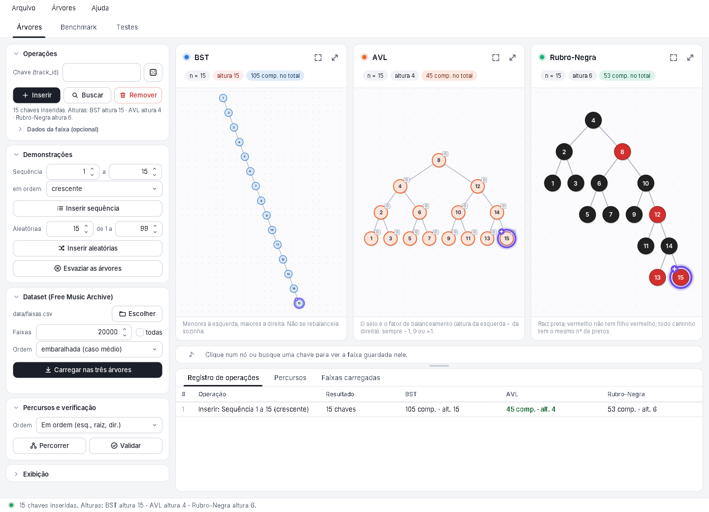
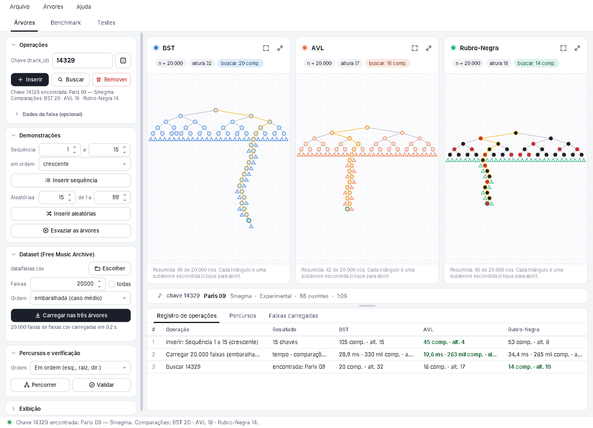
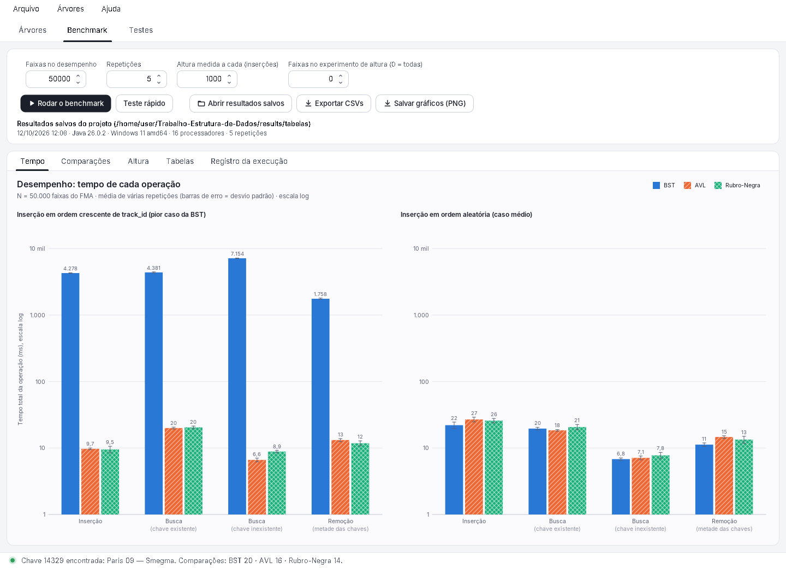
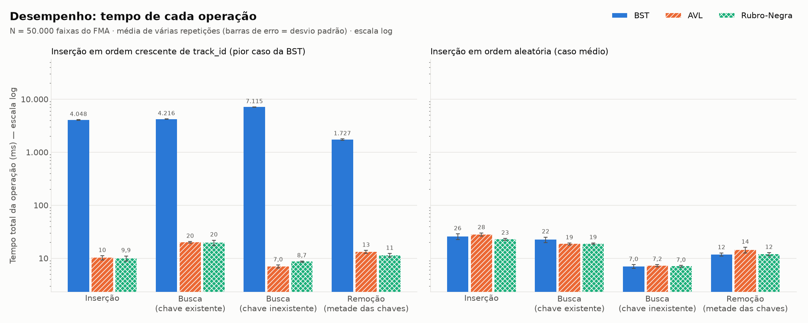
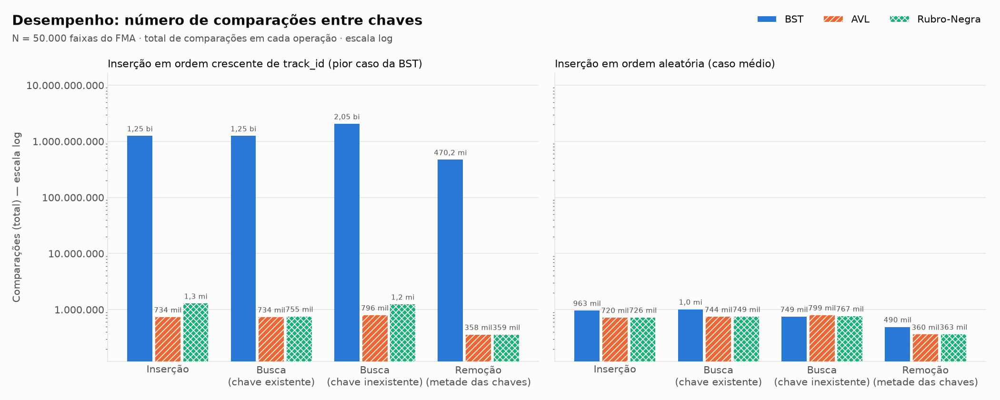
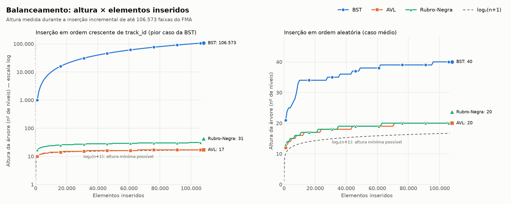

🌳 Estruturas de Dados em Árvore: BST, AVL e Rubro-Negra

> Projeto da disciplina de **Estrutura de Dados** (Engenharia de Computação – IFC São Bento do Sul) que implementa, em Java, uma árvore binária de busca e duas árvores balanceadas e as compara usando um conjunto de dados real de músicas, o **Free Music Archive (FMA)**.


---

## 📑 Sumário

- [Sobre o Projeto](#-sobre-o-projeto)
- [Objetivos](#-objetivos)
- [Estruturas Implementadas](#-estruturas-implementadas)
- [Interface Gráfica](#-interface-gráfica)
- [Conjuntos de Dados](#-conjuntos-de-dados)
- [Requisitos](#-requisitos)
- [Como Executar](#-como-executar)
- [Metodologia dos Experimentos](#-metodologia-dos-experimentos)
- [Resultados](#-resultados)
- [Análise e Discussão](#-análise-e-discussão)
- [Testes](#-testes)
- [Referências](#-referências)

---

## 📖 Sobre o Projeto

Este projeto implementa três árvores de busca em Java — **BST** (árvore binária de busca sem balanceamento), **AVL** e **Rubro-Negra** — com as operações de inserção, busca, remoção, altura, percursos e contagem de comparações. As três seguem a mesma interface (`Arvore`), o que permite rodar exatamente os mesmos experimentos em cada uma.

Usamos metadados reais de faixas do Free Music Archive (chave: `track_id`) para comparar **tempo de execução, número de comparações e altura** de cada estrutura em cenários práticos, como inserção em ordem crescente (pior caso da BST) e em ordem aleatória (caso médio), e assim entender as vantagens e desvantagens de cada uma.

Tudo isso pode ser explorado numa **interface gráfica** que desenha as três árvores de verdade, aplica cada operação às três ao mesmo tempo e mostra o benchmark com gráficos (veja [Interface Gráfica](#-interface-gráfica)).

---

## 🎯 Objetivos

- Implementar uma **Árvore Binária de Busca (BST)**.
- Implementar **duas árvores balanceadas** (AVL e Rubro-Negra), com remoção que mantém o balanceamento.
- Aplicar as estruturas a um **conjunto de dados real** (mínimo de 10.000 registros).
- Comparar **tempo de execução, número de comparações e altura** das árvores.
- Documentar as características de cada estrutura em cenários práticos.
- **Visualizar** as árvores e as operações numa interface gráfica interativa.

---

## 🌲 Estruturas Implementadas

| Estrutura | Arquivo | Balanceamento | Complexidade (pior caso) |
|-----------|---------|---------------|--------------------------|
| Árvore Binária de Busca | `BST.java` | Não possui | O(n) |
| Árvore AVL | `AVL.java` | Rigoroso (fator de balanceamento) | O(log n) |
| Árvore Rubro-Negra | `RubroNegra.java` | Flexível (regras de cor) | O(log n) |

### Operações suportadas

- `inserir(chave, dados)`
- `buscar(chave)` → dados (ou `null` se a chave não existe)
- `remover(chave)` → `true` se a chave existia
- `altura()`
- `percorrer(Ordem.PRE | Ordem.EM | Ordem.POS)` → lista de chaves
- `contadorComparacoes()` e `zerarContador()`
- `tamanho()` e `validar()` (verifica as propriedades da estrutura; usado nos testes)
- `raizVisivel()` → visão **somente leitura** dos nós (`NoVisivel`: chave, dados, filhos, cor ou fator de balanceamento), que a interface gráfica usa para desenhar a árvore sem expor as classes internas

### Convenções (iguais nas três árvores)

- **Chave repetida** em `inserir`: os dados antigos são substituídos e o tamanho não muda.
- **Altura:** número de nós do caminho mais longo da raiz até uma folha (árvore vazia = 0; um único nó = 1).
- **Comparações:** cada comparação entre chaves (`compareTo`) feita em `inserir`, `buscar` e `remover` incrementa o contador.
- **BST iterativa:** todos os métodos da BST usam laços (e não recursão), pois com chaves em ordem crescente a altura chega a ~100 mil e a recursão estouraria a pilha.

---

## 💻 Interface Gráfica

O programa abre numa janela (Java Swing, sem bibliotecas externas) com três abas: **Árvores**, **Benchmark** e **Testes**. O visual é próprio do projeto (claro, de cantos arredondados, com ícones desenhados em código), e a aba *Árvores* tem a coluna de controles à esquerda, as três árvores lado a lado e o registro das operações embaixo.



### Aba "Árvores"

As árvores são **desenhadas a partir das árvores de verdade** e toda operação é aplicada às três ao mesmo tempo:

| Recurso | O que faz |
|---------|-----------|
| **Inserir / Buscar / Remover** | Digite o `track_id` e use os botões (ou Enter). O caminho percorrido acende nó por nó; as rotações da AVL e as mudanças de cor da Rubro-Negra aparecem como animação. O registro mostra quantas **comparações** cada árvore fez (em verde, a menor) e a altura depois da operação. |
| **Demonstrações** | *Inserir sequência* (por exemplo, 1 a 15 em ordem crescente: a BST vira uma lista, enquanto AVL e Rubro-Negra se rearranjam) e *Inserir aleatórias* (o caso médio). |
| **Dataset** | Carrega as faixas de `data/faixas.csv` nas três árvores, em segundo plano, com barra de progresso e botão **Cancelar** (se cancelar, as árvores continuam como estavam). Árvores grandes são **resumidas**: cada triângulo é uma subárvore escondida, e um clique abre só aquela subárvore. O caminho de uma busca é sempre mostrado inteiro. |
| **Percursos** | Pré-ordem, em ordem e pós-ordem: os nós são numerados na ordem de visita e as listas aparecem na aba *Percursos*. |
| **Validar** | Chama `validar()` nas três árvores (ordem das chaves, altura e fator de balanceamento, cores). |
| **Faixa em destaque** | Clique num nó (ou busque uma chave) para ver título, artista, gênero, ouvintes e duração. A aba *Faixas carregadas* lista o dataset com filtro; duplo clique numa faixa busca a chave. |
| **Desenho** | Arraste para mover, rodinha do mouse para zoom, duplo clique no fundo para enquadrar, botão direito para um menu (buscar, remover, abrir subárvore). O botão de expandir, no cabeçalho de cada árvore, mostra só aquela árvore. Em *Exibição* dá para desligar a animação, mudar a velocidade e os limites de níveis. |

Com chaves em ordem crescente a diferença aparece na hora: depois de inserir 1 a 15, a BST tem altura 15 e 105 comparações, a AVL tem altura 4 e 45 comparações, e a Rubro-Negra tem altura 6 e 53.



### Aba "Benchmark"

Roda o mesmo benchmark da linha de comando (`Benchmark`), com andamento na tela e botão **Cancelar**, ou abre os resultados já salvos em `results/tabelas` (eles aparecem assim que a aba é aberta). Mostra os gráficos de **tempo**, **comparações** e **altura** (os mesmos de `results/graficos`, desenhados pela própria interface) e as tabelas, e permite **exportar** os CSVs e os gráficos em PNG (pergunta antes de substituir arquivos). *Teste rápido* usa 10.000 faixas e 2 repetições e termina em poucos segundos.



### Aba "Testes"

Executa `TesteArvore` e `TesteGui` e mostra o resultado ao vivo.

### Como a visualização funciona

- `Arvore.raizVisivel()` devolve uma visão somente leitura dos nós; as classes internas das árvores continuam privadas.
- `ConstrutorDesenho` tira um *retrato* da árvore: só os primeiros níveis (o resto vira triângulo), mais o caminho de uma busca, se houver. Funciona até com uma BST de 100 mil níveis, sem recursão profunda.
- `LayoutArvore` posiciona os nós (estilo Reingold–Tilford) e `VisaoArvore` desenha e anima a diferença entre dois retratos: é assim que as rotações aparecem.
- `arvores.gui.visual` é o visual do programa: um *look and feel* feito sobre o Metal do Java (botões, abas, campos, barras de rolagem, tabelas e ícones desenhados em código), sem nenhuma biblioteca externa. Para trocar as cores e a fonte, basta mexer em `Paleta`.
- Tudo que não depende do Swing (retrato, layout, modelo, carga do dataset) é testado em `arvores.gui.TesteGui`, que também pinta os componentes fora da tela para conferir o visual.

---

## 📊 Conjuntos de Dados

| Dataset | Fonte | Nº de registros | Chave utilizada | Descrição |
|---------|-------|-----------------|-----------------|-----------|
| FMA – metadados de faixas (`tracks.csv`) | [Free Music Archive Dataset](https://github.com/mdeff/fma) · [UCI](https://archive.ics.uci.edu/dataset/386/fma+a+dataset+for+music+analysis) | 106.574 faixas no total; **106.573** em `data/faixas.csv` depois da limpeza (`track_id` de 2 a 155.320) | `track_id` (inteiro único) | Título, artista, gênero principal, número de ouvintes e duração de faixas reais publicadas no Free Music Archive |

---

## ⚙️ Requisitos

- **Java 17 ou superior** (testado com Java 21)
- **Python 3** com `pandas` e `matplotlib` (`pip install pandas matplotlib`) — usado apenas para preparar os dados e gerar os gráficos em PNG pela linha de comando (a interface gráfica já desenha os gráficos sozinha)

---

## 🚀 Como Executar

Os comandos abaixo funcionam no terminal do VS Code (PowerShell ou Git Bash), no Linux e no macOS. Rode todos na pasta do projeto.

### 1. Baixar e preparar os dados

Baixe o arquivo https://os.unil.cloud.switch.ch/fma/fma_metadata.zip (342 MiB) e extraia dentro de `data/`, de modo que exista `data/fma_metadata/tracks.csv`.

```bash
# Linux / macOS / Git Bash
curl -L -o data/fma_metadata.zip https://os.unil.cloud.switch.ch/fma/fma_metadata.zip
unzip data/fma_metadata.zip -d data/

# Windows (PowerShell): use curl.exe (curl, sozinho, é outro comando no PowerShell)
curl.exe -L -o data/fma_metadata.zip https://os.unil.cloud.switch.ch/fma/fma_metadata.zip
tar -xf data/fma_metadata.zip -C data
```

Depois, gere o CSV tratado (a quantidade de faixas aparece no final):

```bash
pip install pandas matplotlib
python scripts/preparar_dados.py data/fma_metadata/tracks.csv data/faixas.csv
```

Se o script avisar de coluna faltando, ele lista as colunas existentes: ajuste o dicionário `COLUNAS` no topo de `scripts/preparar_dados.py`.

### 2. Compilar

```bash
javac -encoding UTF-8 -sourcepath src -d out src/arvores/Main.java src/arvores/Benchmark.java src/arvores/TesteArvore.java
```

> O comando não usa `*`, então funciona igual no PowerShell, no cmd, no Git Bash, no Linux e no macOS (o `-sourcepath src` faz o `javac` achar sozinho as demais classes, inclusive as da interface em `src/arvores/gui`). Se os acentos aparecerem trocados no terminal, rode o Java com `java -Dfile.encoding=UTF-8 -Dstdout.encoding=UTF-8 -cp out ...`.

### 3. Abrir a interface gráfica

```bash
java -cp out arvores.Main                                      # abre a janela
java -cp out arvores.Main data/faixas.csv 20000 embaralhado    # já abre carregando 20.000 faixas
java -cp out arvores.Main data/faixas.csv 20000 ordenado       # pior caso da BST
```

Os argumentos são opcionais: `[csv] [quantidade] [ordenado|embaralhado]`. Para gerar um executável (no Windows e no macOS dá para abrir com duplo clique; ele procura `data/faixas.csv` perto do `.jar`):

```bash
jar --create --file arvores.jar --main-class arvores.Main -C out .
java -jar arvores.jar
```

### 4. Testar

```bash
java -cp out arvores.TesteArvore
java -cp out arvores.gui.TesteGui
```

Os testes também rodam, com o resultado ao vivo, na aba **Testes** da interface.

### 5. Executar o benchmark

```bash
java -cp out arvores.Benchmark
```

Parâmetros opcionais: `java -cp out arvores.Benchmark [csv] [N] [repeticoes] [passo] [pastaSaida] [nAltura]`

| Parâmetro | Descrição | Padrão |
|-----------|-----------|--------|
| `csv` | Dados tratados | `data/faixas.csv` |
| `N` | Nº de faixas no experimento de desempenho (0 = todas) | `50000` |
| `repeticoes` | Repetições de cada medição (usamos a média) | `5` |
| `passo` | A cada quantas inserções medir a altura | `1000` |
| `pastaSaida` | Onde gravar os CSVs | `results/tabelas` |
| `nAltura` | Nº de faixas no experimento de altura (0 = todas) | `0` |

O benchmark grava em `results/tabelas/`: `desempenho.csv`, `altura_incremental.csv` e `ambiente.txt` (versão do Java, sistema e processadores, para a seção "Ambiente de teste"). Na BST com chaves ordenadas as operações são lentas (O(n²) no total): espere alguns minutos. Para um teste rápido: `java -cp out arvores.Benchmark data/faixas.csv 10000 2`.

O mesmo benchmark roda na aba **Benchmark** da interface, que mostra os gráficos e as tabelas sem precisar do Python e só grava arquivos se você pedir (*Exportar CSVs*).

### 6. Gerar os gráficos

```bash
python scripts/gerar_graficos.py
```

Grava em `results/graficos/`: `desempenho_tempo.png`, `desempenho_comparacoes.png` e `altura.png` (altura × elementos inseridos, medida a cada 1.000 inserções até o tamanho total do dataset), além de `results/tabelas/resumo_para_readme.md` com as tabelas prontas para colar na seção [Resultados](#-resultados).
(Caso as imagens não consigam ser visualizadas dentro da IDE, as imagens vão estar salvas dentro das pastas do projeto em seu computador)

---

## 🔬 Metodologia dos Experimentos

**Cenários avaliados** (os mesmos dados, na mesma ordem, para as três árvores):

1. **Inserção em ordem crescente de `track_id`:** pior caso para a BST.
2. **Inserção em ordem aleatória** (embaralhamento com semente fixa, para ser reproduzível): caso médio.

**Operações medidas em cada cenário:** inserção de todas as faixas; busca de todas as chaves existentes; busca do mesmo número de chaves inexistentes; remoção de metade das chaves, em ordem aleatória. Ao final, `validar()` confirma que cada árvore continua correta.

**Métricas coletadas:**

- Tempo de execução de cada operação (ms): média e desvio padrão de 5 repetições, depois de um aquecimento da JVM
- Número de comparações entre chaves
- Altura após cada etapa e altura a cada 1.000 inserções (balanceamento)
- Uso de memória: não medido (opcional no enunciado)

**Ambiente de teste** (gerado pelo próprio benchmark em `results/tabelas/ambiente.txt`):

| Item | Valor |
|------|-------|
| Java | 26.0.2 (Java HotSpot 64-Bit Server VM) |
| Sistema | Windows 11 (amd64) |
| Processadores lógicos | 16 |
| Memória máxima da JVM | 3.944 MB |
| Dataset | `data/faixas.csv` (106.573 faixas) |
| N do experimento de desempenho | 50.000 faixas |
| Repetições | 5 |
| Passo da altura | 1.000 inserções |
| Semente do embaralhamento | 2026 |

---

## 📈 Resultados

Resultados do benchmark rodado no ambiente descrito acima. Os tempos são o **total** de cada conjunto de operações (média de 5 repetições, em ms) e variam de uma execução para outra; as **comparações** e as **alturas** não dependem da máquina. Os números completos estão em `results/tabelas/desempenho.csv` e `results/tabelas/altura_incremental.csv`.

### Altura final (todas as 106.573 faixas inseridas)

| Cenário | BST | AVL | Rubro-Negra |
|---------|-----|-----|-------------|
| Ordem crescente de `track_id` | **106.573** | 17 | 31 |
| Ordem aleatória | 40 | 20 | 20 |

### Desempenho — inserção em ordem crescente de `track_id` (pior caso da BST), N = 50.000

| Estrutura | Inserção (ms) | Busca existente (ms) | Busca inexistente (ms) | Remoção (ms) | Comparações (inserção) | Altura após inserir | Altura após remover |
|-----------|---------------|----------------------|------------------------|--------------|------------------------|---------------------|---------------------|
| BST | 4.047,7 | 4.215,8 | 7.115,1 | 1.726,9 | 1.249.975.000 | 50.000 | 25.000 |
| AVL | 10,2 | 20,0 | 7,0 | 13,1 | 734.465 | 16 | 16 |
| Rubro-Negra | 9,9 | 19,5 | 8,7 | 11,4 | 1.286.225 | 29 | 17 |

### Desempenho — inserção em ordem aleatória (caso médio), N = 50.000

| Estrutura | Inserção (ms) | Busca existente (ms) | Busca inexistente (ms) | Remoção (ms) | Comparações (inserção) | Altura após inserir | Altura após remover |
|-----------|---------------|----------------------|------------------------|--------------|------------------------|---------------------|---------------------|
| BST | 25,6 | 22,4 | 7,0 | 11,7 | 962.667 | 38 | 34 |
| AVL | 28,0 | 18,6 | 7,2 | 14,3 | 720.039 | 18 | 17 |
| Rubro-Negra | 22,7 | 18,9 | 7,0 | 11,9 | 725.785 | 19 | 18 |

### Gráficos





---

## 🧠 Análise e Discussão

- **Degradação da BST:** com chaves em ordem crescente a BST virou uma lista: altura de 106.573 com todas as faixas e 1.249.975.000 comparações para inserir 50.000 chaves, exatamente n(n−1)/2 (comportamento O(n) por operação, O(n²) no total). Inserir levou cerca de 4 s, contra cerca de 10 ms na AVL e na Rubro-Negra (centenas de vezes mais). A busca por chave inexistente foi a mais cara (cerca de 7 s). O benchmark completo levou quase 2 minutos, quase todo gasto na BST ordenada.
- **Caso médio:** com chaves embaralhadas a BST se comportou bem (altura 40; 38 com 50.000 faixas) e ficou na mesma ordem de grandeza das balanceadas. Chegou a inserir mais rápido que a AVL, que paga o custo das rotações.
- **Buscas, inserções e remoções:** nos tempos, AVL e Rubro-Negra ficaram praticamente empatadas; diferenças de poucos milissegundos estão dentro do ruído de medição. Nas comparações, a AVL fez menos que a Rubro-Negra na inserção ordenada (734.465 contra 1.286.225), porque a árvore ficou mais baixa (16 contra 29).
- **AVL × Rubro-Negra:** a AVL é mais rígida e manteve altura menor (17 e 20 com todas as faixas; limite teórico ≈ 24). A Rubro-Negra é mais flexível: 31 (ordenado, perto do limite teórico ≈ 33) e 20 (aleatório). As duas garantem O(log n) nos dois cenários, e a remoção também manteve o equilíbrio (alturas continuaram baixas depois de remover metade das chaves).
- **Aplicações:** se os dados podem chegar ordenados, ou parcialmente ordenados, uma árvore balanceada é a escolha segura. A Rubro-Negra é a usada em bibliotecas padrão (`TreeMap` do Java); a AVL tende a favorecer cargas com muitas buscas. A BST simples só se justifica quando a ordem de entrada é realmente aleatória.
- **Limitações:** um único dataset e uma única máquina; tempos dependem da JVM (por isso aquecimento e repetições); memória não medida; o experimento de desempenho usa 50.000 das 106.573 faixas (a altura usa todas); chaves inteiras "encaixotadas" (`Integer`). Como melhorias: medir memória, testar chaves de texto e outros datasets e comparar com uma árvore B.

---

## ✅ Testes

```bash
java -cp out arvores.TesteArvore
java -cp out arvores.gui.TesteGui
```

`TesteArvore` (1.193.306 verificações aprovadas) compara cada árvore com o `TreeMap` do Java em milhares de operações aleatórias (inserir, remover e buscar) e chama `validar()` depois de cada operação. Também confere os três percursos, o contador de comparações, chaves repetidas, inserção em ordem crescente e decrescente e o limite de altura logarítmica das árvores balanceadas, e que `raizVisivel()` espelha a árvore (mesmas chaves, dados, percursos, cores e fatores de balanceamento).

`TesteGui` (63.371 verificações aprovadas) testa a interface sem abrir janela: o retrato das árvores (níveis resumidos, caminho da busca, subárvore em foco, layout), as operações aplicadas às três árvores (o nº de comparações de cada árvore bate com o caminho calculado pela interface), a carga do dataset com cancelamento, o benchmark e o visual dos componentes (pintados fora da tela).

---

## 📚 Referências

- DEFFERRARD, M.; BENZI, K.; VANDERGHEYNST, P.; BRESSON, X. **FMA: A Dataset for Music Analysis**. In: 18th International Society for Music Information Retrieval Conference (ISMIR), 2017. Disponível em: <https://arxiv.org/abs/1612.01840>. Dados: <https://github.com/mdeff/fma>.
- CORMEN, T. H. et al. **Algoritmos: Teoria e Prática**. 3. ed. Rio de Janeiro: Elsevier, 2012. (Rubro-Negra: cap. 13)
- GOODRICH, M. T.; TAMASSIA, R. **Estruturas de Dados & Algoritmos em Java**. Bookman, 2013.
- SEDGEWICK, R.; WAYNE, K. **Algorithms**. 4. ed. Addison-Wesley, 2011.
- Visualizador de árvores: <https://www.cs.usfca.edu/~galles/visualization/>
- Documentação da API Java: <https://docs.oracle.com/en/java/javase/21/docs/api/>

---
